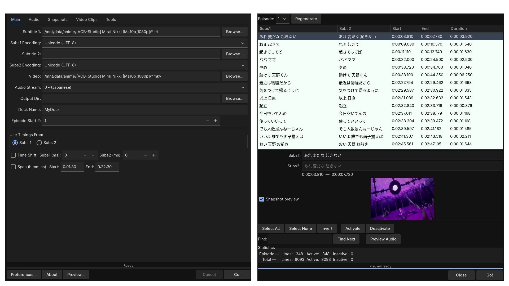

# subs2srs

[](https://aur.archlinux.org/packages/subs2srs-gui)
[](https://github.com/ajatt-tools/subs2srs/actions/workflows/ci.yml)
[](https://tatsumoto-ren.github.io/blog/join-our-community.html)

[](https://github.com/fkzys/specs)



A tool that creates [Anki](https://apps.ankiweb.net/) flashcards from movies
and TV shows with subtitles, for language learning.

This is a **GTK4 / .NET 10** rewrite of the UI layer.
The processing core (subtitle parsing, ffmpeg calls, SRS generation)
is carried over from the original with minimal changes.

## Credits

- [Christopher Brochtrup](https://sourceforge.net/projects/subs2srs/) — original author
- [erjiang](https://github.com/erjiang/subs2srs) — Linux/Mono port
- [nihil-admirari](https://github.com/nihil-admirari/subs2srs-net48-builds) — updated dependencies

## Docs

- **[notes](docs/notes.md)**
    - [What changed](docs/notes.md#what-changed)
        - [Removed components](docs/notes.md#removed-components)
    - [Adding a new preference](docs/notes.md#adding-a-new-preference)
    - [Building with VobSub support](docs/notes.md#building-with-vobsub-support)

## Build

```sh
make build
```

## Test
```sh
make test
```

## Install

### AUR

```sh
yay -S subs2srs-gui
```

### Manual

```sh
git clone https://github.com/ajatt-tools/subs2srs.git
cd subs2srs
sudo make install
```

Installs to `/usr/lib/subs2srs/`, launcher to `/usr/bin/subs2srs`.

### Uninstall

```sh
sudo make uninstall
```

## Configuration

On first run, `preferences.json` is created in
`~/.config/subs2srs/`.

If a `preferences.txt` from a previous version exists in the same directory,
it is automatically migrated to JSON on first launch. The old file is left
intact.

Projects are saved as `.s2s.json` files (File, Save/Load Project).

Edit preferences via **Preferences** dialog or by editing `preferences.json`
directly.

### Parallelism

Set `max_parallel_tasks` in Preferences, Misc (or in `preferences.json`):
- `0` — auto (number of CPU cores, default)
- `1` — sequential (no parallelism)
- `N` — use up to N threads for media generation

## Dependencies

**Runtime:**
- [.NET 10+](https://dotnet.microsoft.com/)
- [GTK 4](https://gtk.org/)
- [ffmpeg](https://ffmpeg.org/)
- [mp3gain](https://mp3gain.sourceforge.net/) *(only if using audio normalization)*
- [mkvtoolnix](https://mkvtoolnix.download/) (`mkvextract`, `mkvinfo`) *(only for MKV track extraction)*

**Build:**
- [.NET 10+ SDK](https://dotnet.microsoft.com/)

**Optional:**
- [noto-fonts-cjk](https://github.com/notofonts/noto-cjk) — for Japanese/Chinese/Korean text

## License

[GPL-3.0-or-later](https://www.gnu.org/licenses/gpl-3.0.html)
